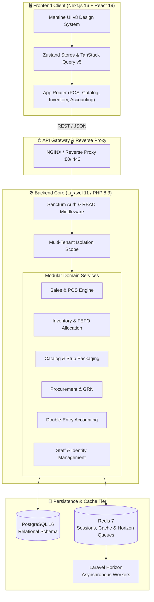
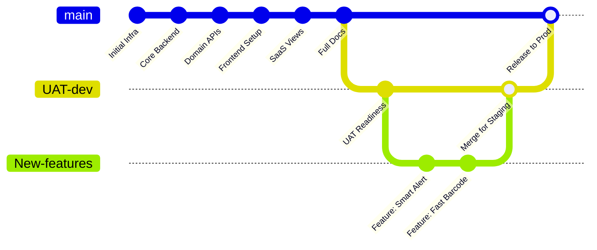

<p align="center">
  <picture>
    <source media="(prefers-color-scheme: dark)" srcset="https://capsule-render.vercel.app/api?type=waving&color=gradient&customColorList=1,12,24&height=260&section=header&text=PHARMALYTICS&fontSize=70&fontAlignY=38&desc=Next-Generation%20Multi-Tenant%20Pharmacy%20SaaS%20%26%20Intelligent%20Analytics&descFontSize=20&descAlignY=62&fontColor=ffffff">
    
  </picture>
</p>

<p align="center">
  <strong>An enterprise-grade, cloud-native Pharmacy Management & Intelligent Analytics SaaS platform built for retail pharmacies, clinical dispensaries, and pharmaceutical retail chains.</strong>
</p>

<p align="center">
  <a href="https://laravel.com"></a>
  <a href="https://php.net"></a>
  <a href="https://nextjs.org"></a>
  <a href="https://react.dev"></a>
  <a href="https://mantine.dev"></a>
  <a href="https://www.postgresql.org"></a>
  <a href="https://redis.io"></a>
  <a href="https://www.docker.com"></a>
</p>

---

## 📑 Interactive Table of Contents

- [Executive Overview](#-executive-overview)
- [Interactive SaaS Feature Tour](#-interactive-saas-feature-tour)
  - [1. Lightning-Fast POS & Prescription Billing](#1-lightning-fast-pos--prescription-billing)
  - [2. Intelligent Batch, Expiry & Inventory Tracking](#2-intelligent-batch-expiry--inventory-tracking)
  - [3. Complete Pharmaceutical Catalog & Packaging Matrix](#3-complete-pharmaceutical-catalog--packaging-matrix)
  - [4. Automated Procurement & Goods Receipt (GRN)](#4-automated-procurement--goods-receipt-grn)
  - [5. Automated Double-Entry Bookkeeping & Accounting](#5-automated-double-entry-bookkeeping--accounting)
  - [6. Multi-Tenant Isolation & Granular RBAC](#6-multi-tenant-isolation--granular-rbac)
  - [7. Executive Analytics & KPI Intelligence](#7-executive-analytics--kpi-intelligence)
- [System Architecture & SaaS Topology](#-system-architecture--saas-topology)
- [Git Branching Strategy & Lifecycle](#-git-branching-strategy--lifecycle)
- [Getting Started & Local Installation](#-getting-started--local-installation)
  - [Option A: Docker Orchestration (Recommended)](#option-a-docker-orchestration-recommended)
  - [Option B: Manual Local Setup](#option-b-manual-local-setup)
- [RESTful API & Swagger / OpenAPI Reference](#-restful-api--swagger--openapi-reference)
- [Directory Structure](#-directory-structure)
- [Contribution & Security Guidelines](#-contribution--security-guidelines)
- [License](#-license)

---

## 💡 Executive Overview

**Pharmalytics** is an end-to-end, multi-tenant Software-as-a-Service (SaaS) solution tailored to resolve the core operational, financial, and clinical compliance bottlenecks in modern pharmacy management. 

Traditional pharmacies struggle with fragmented inventory, stock expiration leakages, untracked strip/tablet packaging splits, and manual reconciliation between point-of-sale registers and financial ledgers. Pharmalytics unifies all clinical dispensary workflows, inventory logistics, procurement lifecycles, and double-entry accounting into a reactive, high-performance web experience.

### Core Value Drivers
- **Multi-Tenant Foundation**: Complete isolation per pharmacy or clinic branch with independent roles, data models, and country localization.
- **Unit & Strip Package Subdivision**: Sell entire boxes, individual blisters/strips, or loose tablets with automatic real-time stock recalculations.
- **FEFO/FIFO Stock Allocation**: Automatically allocates stock from batches nearest to expiry to eliminate obsolescence and wastage.
- **Automated Real-Time Accounting**: Every checkout, return, and goods receipt instantly logs double-entry journal entries directly to your Chart of Accounts.
- **Audit-Ready Compliance**: Full audit trails for scheduled drugs, prescription records, doctor associations, and user permissions.

---

## 🖥️ Interactive SaaS Feature Tour

<details open>
<summary><h3>1. Lightning-Fast POS & Prescription Billing</h3></summary>

The **Pharmalytics POS engine** is optimized for high-volume dispensaries where speed, precision, and patient safety are paramount.

```
┌────────────────────────────────────────────────────────────────────────────────────────┐
│  PHARMALYTICS DISPENSARY POS TERMINAL                                  [Register #01]  │
├──────────────────────────────────────┬─────────────────────────────────────────────────┤
│  🔍 Scan Barcode or Search (F2)      │  PATIENT / RX SUMMARY                           │
│  [ 890123456789             ] [OK]   │  Patient: John Doe | Doctor: Dr. Sarah Smith    │
├──────────────────────────────────────┼─────────────────────────────────────────────────┤
│  PRODUCT              QTY   UNIT     │  TOTAL BREAKDOWN                                │
│  Augmentin 625mg      2     Box      │  Subtotal:                 $48.50               │
│  Panadol Extra        5     Strip    │  Tax (GST 5%):              $2.42               │
│  Nexium 40mg          1     Box      │  Discount:                  $0.00               │
│                                      │  ─────────────────────────────────              │
│  [+] Add Custom Item  [-] Remove     │  GRAND TOTAL:              $50.92               │
├──────────────────────────────────────┴─────────────────────────────────────────────────┤
│  PAYMENT METHODS: [x] Cash ($20.00)  [x] Credit Card ($30.92)  [ ] Health Insurance    │
│  [ F9: PRINT RECEIPT ]       [ F10: SPLIT PAYMENT ]       [ ESC: HOLD ORDER ]          │
└────────────────────────────────────────────────────────────────────────────────────────┘
```

#### Key Capabilities:
- **Barcode & Hotkey Driven**: Fast keyboard navigation (`F2` search, `F9` checkout, `ESC` hold).
- **Split Tender Payments**: Mix Cash, Credit Card, Direct Bank Debit, and Insurance claims in a single invoice.
- **Strip & Unit Breakdown**: Disallow inventory errors when pharmacists sell blister packs cut from a parent box.
- **Doctor & Prescription Tracking**: Attach prescriber information, patient records, and dispensing notes for regulatory compliance.
- **Hold & Resume Carts**: Serve urgent customers while preserving long-dispensation carts in temporary queue states.
</details>

---

<details>
<summary><h3>2. Intelligent Batch, Expiry & Inventory Tracking</h3></summary>

Prevent write-offs and medication loss with multi-tiered expiry forecasting and automated stock allocation.

```
┌────────────────────────────────────────────────────────────────────────────────────────┐
│  INVENTORY AUDIT & EXPIRY RISK MONITOR                                                 │
├───────────────────┬──────────────┬──────────────┬───────────────┬──────────────────────┤
│ BATCH NUMBER      │ MEDICINE     │ LOCATION     │ EXPIRY DATE   │ STATUS               │
├───────────────────┼──────────────┼──────────────┼───────────────┼──────────────────────┤
│ BATCH-2024-09A    │ Amoxicillin  │ Warehouse A  │ 15 Days Left  │ 🔴 CRITICAL EXPIRY   │
│ BATCH-2024-11C    │ Omeprazole   │ Shelf B-03   │ 45 Days Left  │ 🟡 EXPIRING SOON     │
│ BATCH-2025-06F    │ Paracetamol  │ Shelf A-01   │ 420 Days Left │ 🟢 OPTIMAL STOCK     │
├───────────────────┴──────────────┴──────────────┴───────────────┴──────────────────────┤
│  [+] Adjust Stock    [⇄] Transfer Bin    [⚡] Run Auto-FEFO Allocation    [⬇ Export]    │
└────────────────────────────────────────────────────────────────────────────────────────┘
```

#### Key Capabilities:
- **Multi-Warehouse & Shelf Bins**: Track stock across central distribution warehouses, store backrooms, and shelf bins.
- **FEFO (First-Expired, First-Out)**: System prompts cashiers to pick oldest viable inventory first.
- **Automated Expiry Warnings**: Color-coded urgency alerts (Critical <30d, Warning <60d, Healthy).
- **Stock Reconciliation & Adjustments**: Log physical count discrepancies with adjustment reasons (Damage, Breakage, Expiry Disposal, Found Stock).
</details>

---

<details>
<summary><h3>3. Complete Pharmaceutical Catalog & Packaging Matrix</h3></summary>

Standardized medicinal database supporting generic substitutions, therapeutic classifications, and custom unit conversions.

```
┌────────────────────────────────────────────────────────────────────────────────────────┐
│  MEDICINE CATALOG DETAIL MATRIX                                                        │
├────────────────────────────────────────────────────────────────────────────────────────┤
│  Generic Name:     Amoxicillin + Clavulanic Acid                                       │
│  Brand Name:       Augmentin 625mg Tablets                                             │
│  Therapeutic:      Antimicrobial / Antibacterial (J01CR02)                             │
│  Packaging Unit:   1 Box = 2 Strips = 14 Film-Coated Tablets                          │
├───────────────────────────┬───────────────────────────┬────────────────────────────────┤
│  COST PRICING             │  RETAIL PRICE (BOX)       │  STRIP PRICE                   │
│  $12.50 / Box             │  $18.00 (44% Margin)      │  $9.50 / Strip                 │
├───────────────────────────┴───────────────────────────┴────────────────────────────────┤
│  Form: Solid Oral Tablet  │  Prescription Required: Yes  │  Requires Cold Chain: No     │
└────────────────────────────────────────────────────────────────────────────────────────┘
```

#### Key Capabilities:
- **Hierarchical Packaging**: Define conversion rates (e.g., 1 Box = 10 Strips = 100 Tablets) with independent pricing rules.
- **Generic Substitution Lookup**: Suggest cost-effective bio-equivalent alternatives when specific brands are out of stock.
- **Dynamic Markup Calculation**: Set target gross margins to automatically adjust retail rates upon supplier cost fluctuations.
</details>

---

<details>
<summary><h3>4. Automated Procurement & Goods Receipt (GRN)</h3></summary>

Streamline vendor supply chains from Purchase Order creation to warehouse docking and supplier invoice matching.

```
┌────────────────────────────────────────────────────────────────────────────────────────┐
│  PURCHASE ORDER: PO-2026-00421                      VENDOR: Pfizer Global Logistics    │
├─────────────┬───────────────────────────┬──────────────┬──────────────┬────────────────┤
│ STATUS      │ ORDERED DATE              │ EXPECTED     │ TOTAL ITEMS  │ PO AMOUNT      │
│ APPROVED    │ 2026-10-28                │ 2026-11-03   │ 1,500 Units  │ $14,820.00     │
├─────────────┴───────────────────────────┴──────────────┴──────────────┴────────────────┤
│  [+] Create Goods Receipt Note (GRN)     [🔍 Verify Landed Cost]     [📄 Download PDF] │
└────────────────────────────────────────────────────────────────────────────────────────┘
```

#### Key Capabilities:
- **Purchase Order Approval Pipeline**: Multi-stage approval (Draft -> Submitted -> Approved -> Received).
- **Goods Receipt Quality Inspection**: Mandatory input of batch numbers, manufacturing dates, and verified expiry dates during receiving.
- **Landed Cost Allocation**: Incorporate freight, customs duties, and handling charges into raw inventory valuation.
- **Automatic Accounts Payable**: Generates supplier billings upon receipt approval with matching purchase variance detection.
</details>

---

<details>
<summary><h3>5. Automated Double-Entry Bookkeeping & Accounting</h3></summary>

Say goodbye to end-of-month reconciliation headaches. Every operational action generates immutable journal entries.

```
┌────────────────────────────────────────────────────────────────────────────────────────┐
│  GENERAL JOURNAL: ENTRY #JE-89104 (POS Sale TXN #10892)                                │
├──────────────┬───────────────────────────────────────────┬──────────────┬──────────────┤
│ ACCOUNT CODE │ ACCOUNT TITLE                             │ DEBIT ($)    │ CREDIT ($)   │
├──────────────┼───────────────────────────────────────────┼──────────────┼──────────────┤
│ 1010-01      │ Cash in Drawer                            │ 50.92        │ -            │
│ 4010-00      │ Pharmacy Sales Revenue                    │ -            │ 48.50        │
│ 2020-00      │ Sales Tax Payable (GST)                   │ -            │ 2.42         │
│ 5010-00      │ Cost of Goods Sold (COGS)                 │ 28.10        │ -            │
│ 1050-00      │ Pharmacy Inventory Asset                  │ -            │ 28.10        │
├──────────────┴───────────────────────────────────────────┼──────────────┼──────────────┤
│ BALANCED TRANSACTION TOTALS                              │ $79.02       │ $79.02       │
└──────────────────────────────────────────────────────────┴──────────────┴──────────────┘
```

#### Key Capabilities:
- **Standard Chart of Accounts (COA)**: Pre-configured assets, liabilities, equity, revenues, and cost centers out of the box.
- **Zero-Touch Automation**: COGS, inventory drawdown, tax liabilities, and accounts receivable trigger on checkout.
- **Financial Statements**: Instant generation of Balance Sheets, Profit & Loss (P&L) statements, and Trial Balances.
</details>

---

<details>
<summary><h3>6. Multi-Tenant Isolation & Granular RBAC</h3></summary>

Enterprise-level security ensuring each pharmacy's data, transactions, and staff operate in walled tenant boundaries.

- **Tenant Scoping**: All queries are automatically scoped by `tenant_id`.
- **Predefined Roles**:
  - `Owner / Administrator`: Full tenant configuration, financials, and staff administration.
  - `Pharmacist`: Prescription validation, medicine dispensing, batch inspection, and stock returns.
  - `Cashier`: Fast POS operation, receipt printing, and daily register reconciliation.
  - `Inventory Manager`: Procurement orders, GRN receiving, stock adjustments, and supplier tracking.
  - `Accountant`: Journal reviews, tax reconciliation, ledger auditing, and financial statement exports.
</details>

---

<details>
<summary><h3>7. Executive Analytics & KPI Intelligence</h3></summary>

Make data-driven procurement and merchandising decisions with interactive charts powered by **ApexCharts** and real-time backend aggregation.

- **Revenue & Gross Profit Trends**: Daily, weekly, and monthly margin tracking.
- **Top Moving SKUs**: Discover highest-turnover medications to negotiate supplier volume rebates.
- **Stockout & Expiry Projections**: Predictive metrics warning of anticipated stock depletion based on 30-day velocity.
</details>

---

## 🏗️ System Architecture & SaaS Topology



---

## 🌿 Git Branching Strategy & Lifecycle

Pharmalytics uses a structured 3-branch lifecycle designed for zero-downtime releases, reliable quality assurance, and clean feature segregation:



### Branch Responsibilities:

| Branch | Environment | Purpose | Access & Rules |
| :--- | :--- | :--- | :--- |
| **`New-features`** | Local / Sandbox / Dev | **Primary development branch**. All new feature branches, refactoring, and bug fixes are developed or merged here. | Fast iteration. Pull Requests created from feature branches (`feat/*`, `fix/*`). |
| **`UAT-dev`** | UAT / Staging Server | **User Acceptance Testing (UAT)**. Client previews, QA validation, regression testing, and security scans. | Protected branch. Automated CI test suites must pass before staging deployment. |
| **`Production`** | Live Production Cluster | **Production-grade application server**. Only tested, approved code from `UAT-dev` is deployed to live users. | Strict branch protection. Requires peer approval, green builds, and tagged semantic versions (e.g. `v1.0.0`). |

#### Development Flow:
1. All new work begins on **`New-features`** (or a feature branch branching from `New-features`).
2. Once verified locally, pull requests merge into **`New-features`**.
3. Tested milestones are promoted to **`UAT-dev`** for customer sign-off and end-to-end regression testing.
4. Validated releases are merged into **`Production`** and deployed to live production servers.

---

## 🚀 Getting Started & Local Installation

### Prerequisites
- **Git**
- **Docker Desktop** (for Docker setup) *OR*
- **PHP 8.3+**, **Composer**, **Node.js 20+**, **PostgreSQL 16+**, **Redis** (for native setup)

---

### Option A: Docker Orchestration (Recommended)

1. **Clone the repository:**
   ```bash
   git clone https://github.com/junaidiqbalturk/Pharmalytics.git
   cd Pharmalytics
   ```

2. **Prepare Environment Files:**
   ```bash
   cp .env.example .env
   cp frontend/.env.example frontend/.env.local
   ```

3. **Generate Application Key:**
   ```bash
   composer install --no-scripts
   php artisan key:generate
   ```

4. **Launch with Docker Compose:**
   ```bash
   docker compose up -d --build
   ```

5. **Run Migrations & Seeders inside container:**
   ```bash
   docker compose exec app php artisan migrate:fresh --seed
   ```

6. **Access the Applications:**
   - **Frontend App**: `http://localhost:3000`
   - **Backend API**: `http://localhost:8000/api/v1`
   - **Laravel Horizon Dashboard**: `http://localhost:8000/horizon`

---

### Option B: Manual Local Setup

#### 1. Backend (Laravel 11)
```bash
# Install PHP dependencies
composer install

# Configure environment
cp .env.example .env
php artisan key:generate

# Set your DB_CONNECTION, DB_HOST, DB_DATABASE, etc. in .env
php artisan migrate --seed

# Start backend dev server
php artisan serve --port=8000
```

#### 2. Horizon / Queue Worker
```bash
php artisan horizon
```

#### 3. Frontend (Next.js 16)
```bash
cd frontend

# Install Node dependencies
npm install

# Setup local environment
cp .env.example .env.local

# Start Next.js development server
npm run dev
```

Visit `http://localhost:3000` to interact with the platform.

---

## 📡 RESTful API & Swagger / OpenAPI Reference

Pharmalytics includes a fully typed, versioned **OpenAPI 3.1.2** specification located in [`docs/openapi.json`](file:///docs/openapi.json).

### Core Endpoints Preview:

| Area | HTTP Verb | Endpoint | Description |
| :--- | :--- | :--- | :--- |
| **Auth** | `POST` | `/api/v1/auth/login` | Authenticate user & return Sanctum bearer token |
| **Auth** | `POST` | `/api/v1/auth/register` | Register new organization/tenant & owner user |
| **Catalog** | `GET` | `/api/v1/medicines` | List medications with pagination, category filter & search |
| **Catalog** | `POST` | `/api/v1/medicines` | Create medication with packaging & strip pricing |
| **Inventory** | `GET` | `/api/v1/inventory/batches` | Query stock batches by FEFO expiry date |
| **Inventory** | `POST` | `/api/v1/inventory/adjustments` | Record stock write-off or physical audit adjustment |
| **Sales** | `POST` | `/api/v1/sales/checkout` | Process POS sale, issue receipt, log COGS & journal |
| **Procurement** | `POST` | `/api/v1/procurement/purchase-orders` | Create vendor PO |
| **Procurement** | `POST` | `/api/v1/procurement/goods-receipts` | Receive shipment, verify batches & update inventory |
| **Accounting** | `GET` | `/api/v1/accounting/chart-of-accounts` | List general ledger chart of accounts |
| **Accounting** | `POST` | `/api/v1/accounting/journal-entries` | Post custom balanced double-entry journal |

---

## 📂 Directory Structure

```
Pharmalytics/
├── app/                          # Laravel Application Core
│   ├── Http/Controllers/        # Base Controllers
│   ├── Models/                  # Core Models (User, etc.)
│   ├── Modules/                 # Hexagonal Modular Business Domains
│   │   ├── Accounting/          # Ledger, COA, Journal Entries
│   │   ├── Catalog/             # Medicines, Categories, Packaging
│   │   ├── Foundation/          # Multi-Tenancy, Auth, Tenant Scoping
│   │   ├── Inventory/           # Batches, Stocks, Adjustments, Warehouses
│   │   ├── MasterData/          # Suppliers, Customers, Doctors, Taxes
│   │   ├── Procurement/         # Purchase Orders, Goods Receipt (GRN)
│   │   └── Sales/               # POS Checkout, Invoicing, Split Payments
│   └── Providers/               # Service Providers
├── config/                       # Application Configuration
├── database/
│   ├── migrations/              # Multi-tenant Database Migrations
│   └── seeders/                 # Default COA, Categories & Demo Data
├── docs/
│   └── openapi.json             # Full OpenAPI 3.1.2 Specification
├── frontend/                     # Next.js 16 Web Application
│   ├── app/                     # Next.js App Router Pages
│   │   ├── accounting/          # Financial Ledger & COA UI
│   │   ├── dashboard/           # Analytics & KPI Overview
│   │   ├── inventory/           # Batch & Stock Management UI
│   │   ├── procurement/         # Purchase Order & GRN UI
│   │   ├── sales/               # High-Speed POS Terminal UI
│   │   └── staff/               # Staff & Permissions Management
│   ├── components/              # Shared Mantine UI Component Library
│   ├── features/                # Modular State & Domain Logic
│   └── stores/                  # Zustand Global Application Stores
├── routes/
│   ├── api.php                  # API Route Definitions
│   └── web.php                  # Web Fallbacks
├── docker-compose.yml           # Multi-Container Orchestration
└── Dockerfile                   # Production PHP-FPM Container
```

---

## 🤝 Contribution & Security Guidelines

1. Always branch off **`New-features`** for any bugfix or enhancement:
   ```bash
   git checkout New-features
   git checkout -b feat/your-feature-name
   ```
2. Run code styling and tests before submitting:
   ```bash
   vendor/bin/pint
   php artisan test
   cd frontend && npm run lint
   ```
3. Open a Pull Request targeting **`New-features`**.

### Security Disclosures
For responsible disclosure of security vulnerabilities, please email [junaidiqbalturk@gmail.com](mailto:junaidiqbalturk@gmail.com).

---

## 📄 License

Pharmalytics is open-sourced software licensed under the **[MIT License](https://opensource.org/licenses/MIT)**.
